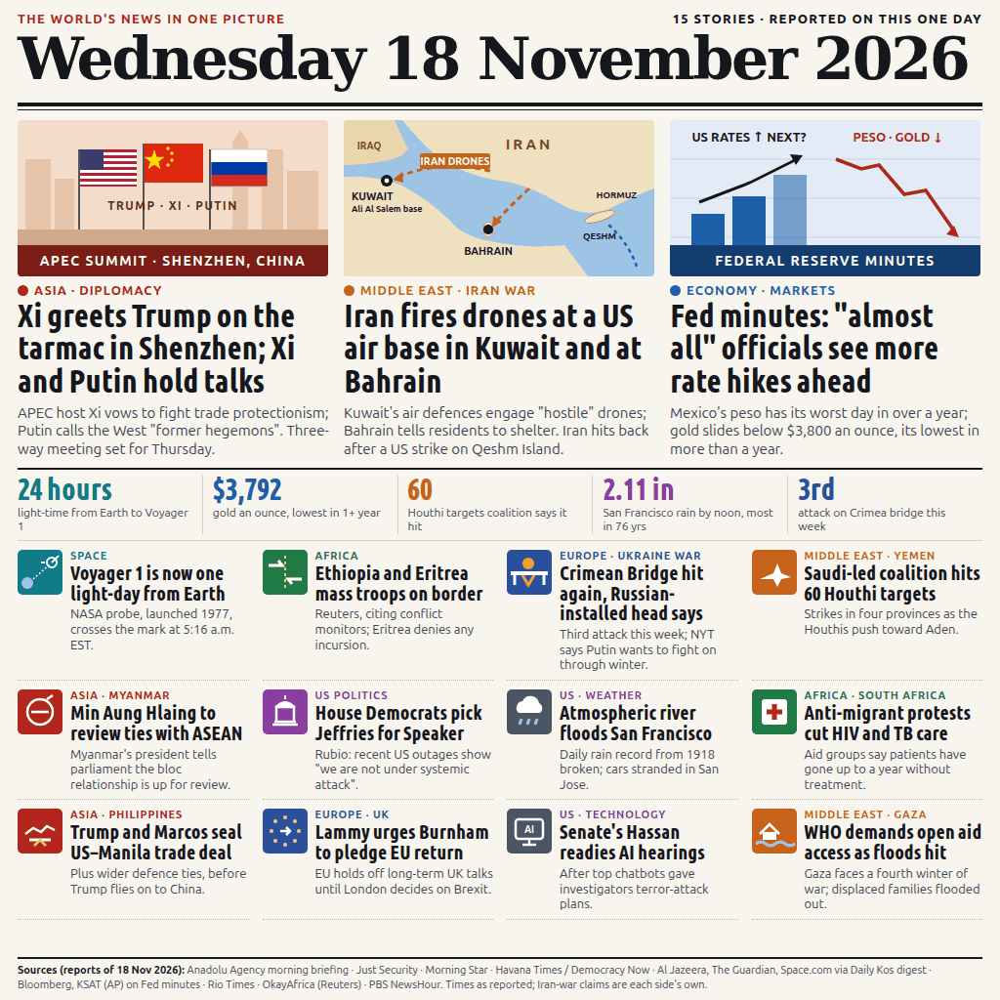

# news-image-20261118

[](LICENSE)
[](https://github.com/putrifransiska/news-image-20261118/commits/main)
[](main.ts)

The world's news of **Wednesday 18 November 2026** in one 1024×1024 picture, entered in make.fun's
`news-image-20261118` contest.



## Run

```sh
mkdir -p out && MAKEFUN_OUTPUT_DIR=out node main.ts
```

`main.ts` (Node 22, standard library only) checks that `entry.png` is a PNG of at most 1 MiB and
1024×1024 pixels, then copies it to `/output/entry.png` (or `$MAKEFUN_OUTPUT_DIR`). It needs no network,
and both runs write the same bytes.

## Rebuild the picture

```sh
PW=<folder with node_modules/playwright-core> node build/render.mjs build/page.html raw.png
node build/pack.mjs raw.png entry.png
```

- `build/page.html` is the layout: date, three lead stories with drawn pictures, a strip of numbers,
  twelve briefs and a source line.
- `build/render.mjs` screenshots it at 1024×1024 in headless Chromium and warns if the date touches the
  rule under it, if any text is clipped, or if the briefs run into the footer.
- `build/pack.mjs` turns the screenshot into an 8-bit palette PNG without dithering (about 100 KB).

## Stories and sources

Only events that happened, or were first reported, on 18 November 2026 (any time zone). Items found to
be from 17 November (Mongolia's president resigning, Thaçi's sentence, the Kemerovo crash, the Knesset
speaker vote, the Board of Peace report) were left out.

| Story | Source |
| --- | --- |
| Xi greets Trump on the tarmac in Shenzhen; Putin–Xi talks; Xi vows to fight protectionism | [Just Security, Early Edition 18 Nov](https://www.justsecurity.org/165038/early-edition-november-18-2026/), [Anadolu Agency, Morning Briefing 18 Nov](https://aa.com.tr/en/world/morning-briefing-nov-18-2026/4128568), [Havana Times / Democracy Now](https://havanatimes.org/news/international-news-briefs-for-wednesday-november-18-2026/) |
| Iran drones at Ali Al Salem Air Base (Kuwait) and Bahrain after US strike on Qeshm | [Anadolu Agency](https://aa.com.tr/en/world/morning-briefing-nov-18-2026/4128568), [Morning Star](https://morningstaronline.co.uk/article/world-brief-61), [Just Security](https://www.justsecurity.org/165038/early-edition-november-18-2026/) |
| Fed minutes: "almost all" officials see more hikes | [Bloomberg](https://www.bloomberg.com/news/articles/2026-11-18/fed-minutes-show-almost-all-officials-expect-more-rate-hikes), [KSAT (AP)](https://www.ksat.com/business/2026/11/18/fed-minutes-higher-interest-rates-needed-in-december-as-inflation-worries-mount/) |
| Mexican peso's worst day in over a year | [Rio Times, Latin American Pulse 19 Nov](https://www.riotimesonline.com/latin-american-pulse-for-thursday-november-19-2026/) |
| Gold below $3,800 ($3,792), lowest in over a year | [Anadolu Agency](https://aa.com.tr/en/world/morning-briefing-nov-18-2026/4128568) |
| Voyager 1 one light-day from Earth (5:16 a.m. EST) | Space.com, via [Daily Kos Overnight News Digest](https://www.dailykos.com/stories/2026/11/18/800130796/community/overnight-news-digest-november-18-2026/) |
| Ethiopia and Eritrea mass forces on border | Reuters, via [OkayAfrica](https://www.okayafrica.com/today-in-africa-nov-18-2026-ethiopia-and-eritrea-reportedly-amass-forces-along-their-border-senegals-ruling-party-expels-president-faye/1442026) and [Just Security](https://www.justsecurity.org/165038/early-edition-november-18-2026/) |
| Crimean Bridge hit a third time this week; NYT: Putin not ready for serious talks | The Guardian, via [Daily Kos](https://www.dailykos.com/stories/2026/11/18/800130796/community/overnight-news-digest-november-18-2026/); [Just Security](https://www.justsecurity.org/165038/early-edition-november-18-2026/) |
| Saudi-led coalition hits 60 Houthi targets | Al Jazeera, via [Daily Kos](https://www.dailykos.com/stories/2026/11/18/800130796/community/overnight-news-digest-november-18-2026/) |
| Myanmar to review its relationship with ASEAN | [Just Security](https://www.justsecurity.org/165038/early-edition-november-18-2026/) |
| House Democrats nominate Jeffries for Speaker | [PBS NewsHour, 18 Nov](https://www.pbs.org/newshour/show/november-18-2026-pbs-news-hour-full-episode) |
| Rubio: "We are not under systemic attack" | [Anadolu Agency](https://aa.com.tr/en/world/morning-briefing-nov-18-2026/4128568), [Morning Star](https://morningstaronline.co.uk/article/world-brief-61) |
| Atmospheric river: San Francisco 2.11 in by noon, 1918 daily record broken | The Guardian, via [Daily Kos](https://www.dailykos.com/stories/2026/11/18/800130796/community/overnight-news-digest-november-18-2026/) |
| South Africa: anti-migrant protests disrupt HIV/TB care | [OkayAfrica](https://www.okayafrica.com/today-in-africa-nov-18-2026-ethiopia-and-eritrea-reportedly-amass-forces-along-their-border-senegals-ruling-party-expels-president-faye/1442026) |
| Trump–Marcos trade deal in Manila | [Anadolu Agency](https://aa.com.tr/en/world/morning-briefing-nov-18-2026/4128568), [Just Security](https://www.justsecurity.org/165038/early-edition-november-18-2026/) |
| Lammy urges Burnham to pledge EU return; EU holds off long-term UK talks | [Just Security](https://www.justsecurity.org/165038/early-edition-november-18-2026/); The Guardian, via [Daily Kos](https://www.dailykos.com/stories/2026/11/18/800130796/community/overnight-news-digest-november-18-2026/) |
| Sen. Hassan prepares AI hearings | [Just Security](https://www.justsecurity.org/165038/early-edition-november-18-2026/) |
| WHO calls for unobstructed Gaza aid as floods hit | [Anadolu Agency](https://aa.com.tr/en/world/morning-briefing-nov-18-2026/4128568) |

Claims about the Iran war are each side's own statements as reported; they were not independently verified.

## License

[MIT](LICENSE).
